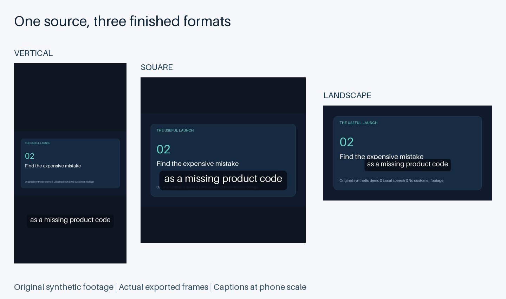

# Video Clipping Agent — reproducible local proof

Turns a rights-confirmed English speech video into complete, captioned clips in vertical, square and landscape formats. Each clip has a source-time range and an explanation tied to its transcript or supplied replay data. A targeted revision preserves the other media and caption files byte for byte.



Prepared for [NEAR's Video Clipping Agent job](https://market.near.ai/jobs/06d8adcb-4635-4d54-83df-4ef7bbbc8344). This public sample is an AI-assisted engineering proof. It does not establish an award, live commercial listing, customer acceptance or earnings.

## What was verified

- A 99.12-second original synthetic video was transcribed locally and cut into three clips, each in all three formats: nine H.264/AAC MP4 files, plus captions and a report.
- All selected caption words match the known original script. Independent checks confirm each cut contains the complete synthesized sentence audio. The full raw transcript has one word substitution out of 249 words, disclosed in `VERIFICATION.json`.
- All nine finished videos fully decoded. A revision changed only clip 02; the other twelve video/caption files retained their exact SHA256 values.
- A separate replay-data test used explicitly synthetic intervals. Its selected passage overlaps the supplied peak. This is a branch test, not real audience analytics.
- Twenty-one unit checks and eleven media/revision checks passed. Actual exported frames were visually inspected at phone scale. Exact retries return a verified no-op.

[Download the complete source and media proof](Video-Clipping-Proof-v0.1.zip). [Open an actual vertical clip](clip-01-vertical.mp4).

## Run locally

Python 3.12, FFmpeg and FFprobe are required. The first transcription may download the free `small.en` speech model; no paid model API is called.

```sh
python3 -m venv .venv
.venv/bin/pip install -r requirements.txt
.venv/bin/python agent.py
.venv/bin/python agent.py create --source input.mp4 --brief brief.json --output delivery
.venv/bin/python agent.py revise --source input.mp4 --original delivery --changes changes.json --output revision
```

Example brief:

```json
{"rights_confirmed":true,"clip_count":3,"formats":["vertical","square"],"captions":true,"minimum_seconds":12,"maximum_seconds":45,"topics":["main lesson"]}
```

Example revision:

```json
{"clips":{"clip-02":{"layout":"center_crop"}}}
```

Revisions also accept `captions` and a zero-based complete-sentence span such as `"sentences":[2,4]`. A supplied corrected transcript must carry this source's SHA256 and word timestamps. The default CLI output is TOON; add `--json` for JSON. Unknown flags fail before processing. Outputs include the exact brief, source hash, captions, report and per-file hashes.

## Inputs and limits

Local MP4/MOV/WebM video with English speech, one audio track, SDR color, at most 60 minutes and 1 GiB. Outputs are 720×1280, 720×720 and 1280×720 at 30 fps. The default fit layout preserves the whole frame; center crop is opt-in and does not track faces. Requests that cannot be satisfied stop with an explanation.

Optional public YouTube ingestion accepts a canonical public video link and a rights-confirmation flag. It uses no cookies or login. A restricted or unavailable link is reported as blocked and an upload is requested. This path has input-validation tests but has not been exercised against a live YouTube video in this proof.

When replay data is absent, selection uses transcript keyword relevance and distinctive terms, labelled as a heuristic. It does not predict virality or infer private retention data. Speech recognition and inferred punctuation can be wrong; review the transcript and finished clips before publishing. Arbitrary unseen audio, multi-speaker framing and customer acceptance remain unverified.

## Source and model credits

The fixture script, artwork and demo are original and synthetic. Its local voice uses Kokoro v1.0 `af_heart`; the [official model card](https://huggingface.co/hexgrad/Kokoro-82M) declares Apache-2.0 model weights. Speech recognition uses [faster-whisper](https://github.com/SYSTRAN/faster-whisper). FFmpeg performs decoding and encoding. No real person's voice was cloned, no buyer footage was used, and no model weights are included in the archive.
